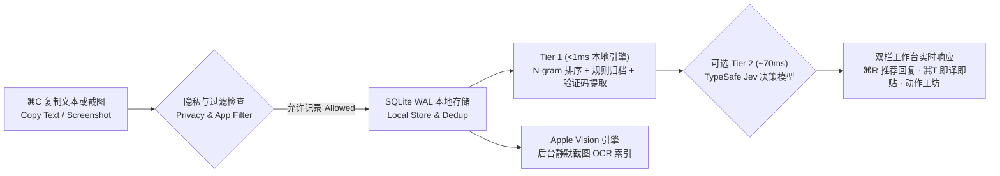

<div align="center">


# 剪贴板记录 · ClipHistory 2.0

**原生 macOS 双栏智能剪贴板工作台**  
*A Native macOS Dual-Pane Smart Clipboard & Text Expansion Workbench*

<p align="center">
  <a href="README.md"><strong>🇨🇳 简体中文</strong></a> &nbsp;·&nbsp;
  <a href="README_EN.md"><strong>🇺🇸 English</strong></a> &nbsp;·&nbsp;
  <a href="https://github.com/deerweek/cliphistory/releases/latest"><strong>⬇️ 下载最新版 / Download v2.0.0</strong></a> &nbsp;·&nbsp;
  <a href="https://github.com/deerweek/cliphistory/issues"><strong>💬 反馈建议 / Issues</strong></a>
</p>

<p align="center">
  <a href="https://github.com/deerweek/cliphistory/releases/latest"></a>
  
  
  
  
  <a href="LICENSE"></a>
</p>

<br/>


</div>

---

## ✨ 为什么选择 ClipHistory 2.0？ · Why ClipHistory 2.0?

> **中文**：大多数剪贴板工具只是一个被动的“复制历史列表”。**ClipHistory 2.0** 将**双栏实时预览**、**全局输入法 `;短码` 自动展开**、**macOS 原生 Vision 截图 OCR 搜索**、**Jev 70ms 智能推荐回复**以及**可插拔 AI / Shell 动作工坊**融为一体——让你从“找回复制过的内容”进化到“一键完成转换与回复”。
>
> **English**: Most clipboard managers are passive history lists. **ClipHistory 2.0** unifies a **Live Dual-Pane Inspector**, **System-Wide `;trigger` Text Expansion**, **Native Apple Vision Screenshot OCR Search**, **Jev 70ms Smart Reply Recommendations**, and a **Pluggable AI / Shell Action Studio** into a single lightweight macOS menu bar app.

<p align="center">
  
</p>

<table>
  <tr>
    <td width="50%" valign="top">
      <h3>🖥 双栏实时预览 · Live Split Inspector (<code>⌘Y</code>)</h3>
      <p>左侧高速定位历史，右侧实时展示完整多行正文、代码等宽排版、<code>#HEX</code> 色块预览、链接域名卡片与高清大图，搜索关键词在列表与预览区同步高亮。</p>
      <p><em>Browse history on the left while inspecting full text, monospaced code, color swatches, and high-res images on the right with live keyword highlighting.</em></p>
    </td>
    <td width="50%" valign="top">
      <h3>⌨️ 全局输入法短码 · Global Text Expander</h3>
      <p>为常用地址、开票税号、邮箱或代码片段绑定如 <code>;dz</code>、<code>@mail</code> 等触发短码。在微信、浏览器或终端任意输入框敲出短码，即刻原地替换为完整内容（支持 <code>{{date}}</code>、<code>{{time}}</code>、<code>{{clipboard}}</code> 动态占位符）。</p>
      <p><em>Bind trigger codes like <code>;dz</code> or <code>@mail</code> to snippets and expand them inline in any macOS app with dynamic template variables.</em></p>
    </td>
  </tr>
  <tr>
    <td width="50%" valign="top">
      <h3>🔍 截图自动 OCR · Native Vision Screenshot OCR</h3>
      <p>复制任何截图或图片后，后台静默调用 macOS 原生 <code>Vision</code> 引擎识别简繁中文与英文并建立索引。直接搜索发票号或报错词即可找出对应截图，支持一键复制图中文字或导出 PNG。</p>
      <p><em>Automatically indexes Chinese & English text inside copied screenshots via Apple's on-device <code>Vision</code> framework so you can search images by the text inside them.</em></p>
    </td>
    <td width="50%" valign="top">
      <h3>⚡ 智能回复与验证码提取 · Smart Reply & OTP Card</h3>
      <p>复制含验证码或快递单号的短信时，顶部自动弹出号码卡片一键粘贴；复制客户或同事提问时，通过本地 N-gram 与可选 <code>Jev</code> 70ms 决策模型推荐最佳快捷回复（<code>⌘R</code> 一键上屏）。</p>
      <p><em>Extracts 4–8 digit OTP codes and tracking numbers into a one-click banner, and recommends matching quick-reply snippets (<code>⌘R</code>) when you copy incoming messages.</em></p>
    </td>
  </tr>
  <tr>
    <td width="50%" valign="top">
      <h3>🪄 可插拔动作工坊 · Pluggable Action Studio</h3>
      <p>内置免配置中英互译（<code>⌘T</code> 即译即贴）、合并 PDF 断行、美化 JSON、去空格与 URL 解码；支持在「动作工坊」中自由创建和原位编辑自定义 AI Prompt 指令或本地 Shell 脚本插件。</p>
      <p><em>Includes zero-config instant translation (<code>⌘T</code>), PDF line-wrap cleaner, and JSON formatter, plus custom AI prompts and local Shell script pipelines.</em></p>
    </td>
    <td width="50%" valign="top">
      <h3>🛡 隐私优先与连续粘贴 · Privacy & Sequential Paste</h3>
      <p>纯本地 SQLite WAL 存储；支持一键暂停记录、敏感应用黑名单（默认排除钥匙串、密码、1Password、Bitwarden）；支持 <code>⇧↵</code> 连续粘贴并自动下移下一条，填表效率翻倍。</p>
      <p><em>100% local SQLite storage with one-click recording pause, app blacklist, JSON backup export/import, and <code>⇧↵</code> sequential paste-and-advance.</em></p>
    </td>
  </tr>
</table>

---

## 🚀 30 秒快速安装 · Quick Installation

### 方式一：直接下载安装包 · Download Prebuilt Release (Recommended)

| 安装包类型 / Package | 适用架构 / Arch | 下载链接 / Download |
| :--- | :--- | :--- |
| **macOS 磁盘映像 (`.dmg`)** | Apple Silicon (`arm64`, macOS 14+) | [**📦 ClipHistory-macos-arm64-v2.0.0.dmg**](https://github.com/deerweek/cliphistory/releases/download/v2.0.0/ClipHistory-macos-arm64-v2.0.0.dmg) |
| **macOS 压缩包 (`.zip`)** | Apple Silicon (`arm64`, macOS 14+) | [**📦 ClipHistory-macos-arm64-v2.0.0.zip**](https://github.com/deerweek/cliphistory/releases/download/v2.0.0/ClipHistory-macos-arm64-v2.0.0.zip) |
| **SHA-256 校验文件** | Checksums | [`.dmg.sha256`](https://github.com/deerweek/cliphistory/releases/download/v2.0.0/ClipHistory-macos-arm64-v2.0.0.dmg.sha256) · [`.zip.sha256`](https://github.com/deerweek/cliphistory/releases/download/v2.0.0/ClipHistory-macos-arm64-v2.0.0.zip.sha256) |

1. 下载并打开 `.dmg` 或解压 `.zip`，将 **`剪贴板记录.app`** 拖入 `~/Applications`（或 `/Applications`）并启动。  
   *Download the `.dmg` or `.zip`, move **`剪贴板记录.app`** into `~/Applications`, and launch it.*
2. 首次启动时，前往 **系统设置 → 隐私与安全性 → 辅助功能**，开启 `剪贴板记录.app` 的权限（用于向目标窗口发送 `⌘V` 自动粘贴及监听全局 `;短码`）。  
   *Grant **Accessibility** permission in **System Settings → Privacy & Security → Accessibility** to enable auto-paste (`⌘V`) and global `;trigger` expansion.*

### 方式二：从源码一键构建安装 · Build from Source

```bash
git clone https://github.com/deerweek/cliphistory.git
cd cliphistory
./scripts/package-app.sh && open ~/Applications/剪贴板记录.app
```

---

## ⌨️ 快捷键速查矩阵 · Keyboard Shortcuts Matrix

| 快捷键 / Shortcut | 中文说明 | English Action |
| :--- | :--- | :--- |
| <kbd>⇧</kbd> <kbd>⌘</kbd> <kbd>V</kbd> / <kbd>⌘</kbd> <kbd>D</kbd> | 呼出 / 收起剪贴板面板（可在设置中切换） | Toggle ClipHistory floating panel |
| <kbd>↑</kbd> / <kbd>↓</kbd> | 上下移动选中条目 | Navigate items up / down |
| <kbd>Tab</kbd> / <kbd>⇧</kbd> <kbd>Tab</kbd> | 循环切换分类（全部 / 文本 / 链接 / 图片 / 快捷回复） | Cycle through category tabs |
| <kbd>↵</kbd>（或双击条目） | **直接粘贴**选中内容到目标窗口 | **Paste** selected item into target app |
| <kbd>⇧</kbd> <kbd>↵</kbd> | **连续粘贴并下移**：粘贴当前项、保持面板不关并自动选中下一条 | **Sequential Paste**: paste current item & advance to next row |
| <kbd>⌘</kbd> <kbd>T</kbd> | **即译即贴**：将选中外文译为中文（或中文译英）并直接粘贴 | **Instant Translate & Paste** (EN ↔ ZH) |
| <kbd>⌘</kbd> <kbd>R</kbd> | 一键粘贴顶部智能推荐的快捷回复 | Paste recommended quick-reply snippet |
| <kbd>⌘</kbd> <kbd>1</kbd> … <kbd>⌘</kbd> <kbd>9</kbd> | 直接粘贴列表中第 1–9 条（配合 <kbd>⌥</kbd> 为仅复制） | Quick-paste item #1–#9 (hold <kbd>⌥</kbd> to copy only) |
| <kbd>⌘</kbd> <kbd>C</kbd> / <kbd>⌥</kbd> <kbd>↵</kbd> | **仅复制**到系统剪贴板，不自动发送粘贴 | **Copy only** to system clipboard without pasting |
| <kbd>⌘</kbd> <kbd>E</kbd> | 编辑当前条目 / 绑定输入法触发 `;短码` | Edit item title, body, or `;trigger` code |
| <kbd>⌘</kbd> <kbd>N</kbd> | 新建快捷回复与短码 | Create new quick-reply snippet |
| <kbd>⌘</kbd> <kbd>Y</kbd> | 展开 / 收起右侧实时预览分栏 | Toggle right-hand Live Inspector pane |
| <kbd>⌥</kbd> <kbd>S</kbd> | 在「快捷回复」与「普通历史」之间一键互转 | Convert between Snippet and History item |
| <kbd>⌥</kbd> <kbd>P</kbd> | 置顶 / 取消置顶选中条目 | Pin / unpin selected item |
| <kbd>⌥</kbd> <kbd>⌫</kbd> | 删除选中条目 | Delete selected item |
| <kbd>Esc</kbd> | 清空当前搜索/筛选条件，再次按下收起面板 | Clear active search/filters, or dismiss panel |

---

## 🧠 智能双层架构 · Two-Tier Smart Architecture



- **Tier 1：`<1ms` 本地零延迟引擎（[`SmartRanker.swift`](Sources/ClipHistory/SmartRanker.swift) & [`ContentClassifier.swift`](Sources/ClipHistory/ContentClassifier.swift)）**
  - **短码精确命中保护（Exact-Match Guardrail）**：输入 `;dz` 等短码时，精确匹配项直接锁定榜首，绝不被高频长文本挤下。
  - **字符级 Unigram + Bigram 混合检索**：兼容中文无空格短语与多关键词分词匹配。
  - **6 类自动语义归档**：自动识别「地址与联系」「代码与命令」「验证码/单号」「外文内容」「工作沟通」。
- **Tier 2：可选 `~70ms` TypeSafe `Jev` System-One 决策模型（[`SmartService.swift`](Sources/ClipHistoryApp/SmartService.swift)）**
  - 在设置中填入可选 API Key 后，后台并行校准最匹配的快捷回复置信度与推荐动作。

---

## 🗂 项目结构与测试 · Project Layout & Testing

```text
Package.swift
Sources/
  ClipHistory/                 跨平台核心库（SQLite WAL、分类器、N-gram 重排、动作引擎、备份导入导出）
  CSQLite/                     Linux SQLite 模块映射
  ClipHistoryApp/              macOS 原生双栏应用（AppKit/SwiftUI、Vision OCR、短码监听、智能翻译）
Tests/
  ClipHistoryTests/            30 项核心单元测试（覆盖去重、排序、OCR 索引、验证码提取与备份还原）
scripts/
  package-app.sh               编译、写入 AppIcon、签名并安装 ~/Applications/剪贴板记录.app
  run-tests.sh                 运行 macOS 完整测试套件
  run-tests-linux.sh           运行 Linux 跨平台核心测试
```

```bash
./scripts/run-tests.sh          # 运行全部 30 项核心单元测试 (macOS)
./scripts/run-tests-linux.sh    # 运行跨平台核心库测试 (Linux)
```

---

## 📄 开源许可 · License

本项目基于 [MIT License](LICENSE) 开源。  
Released under the [MIT License](LICENSE).
